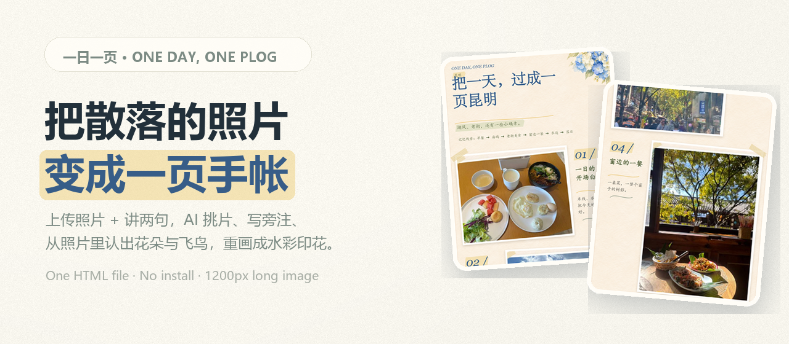
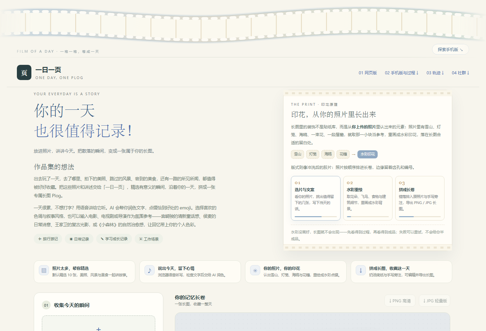
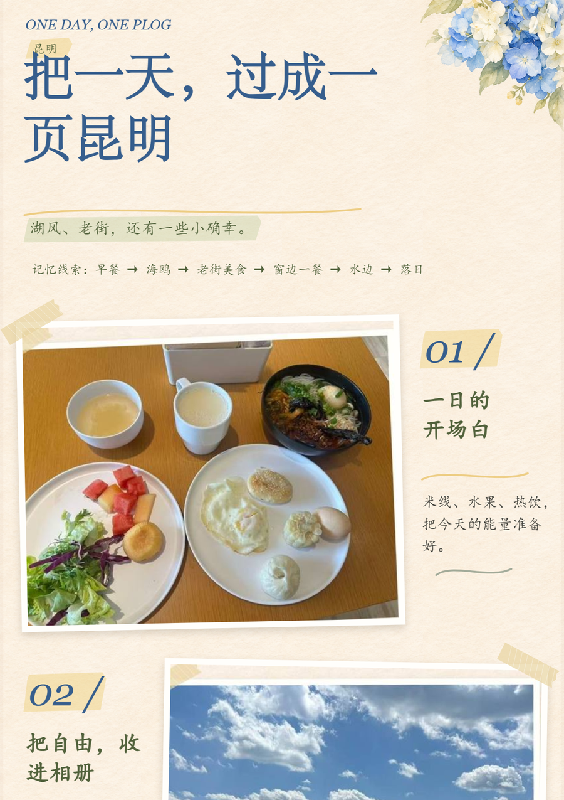
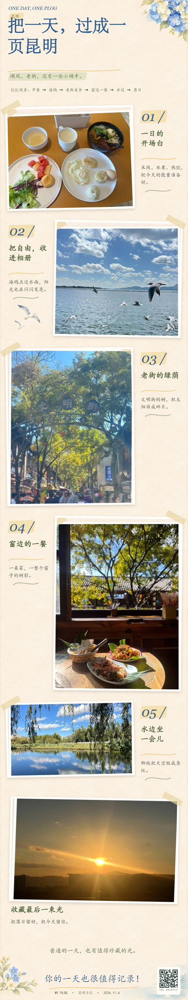
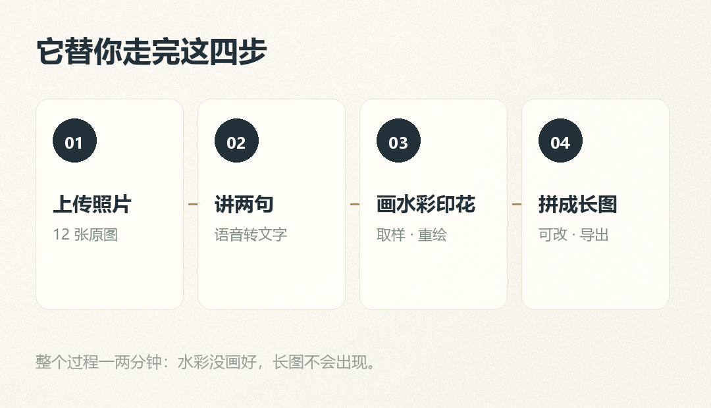
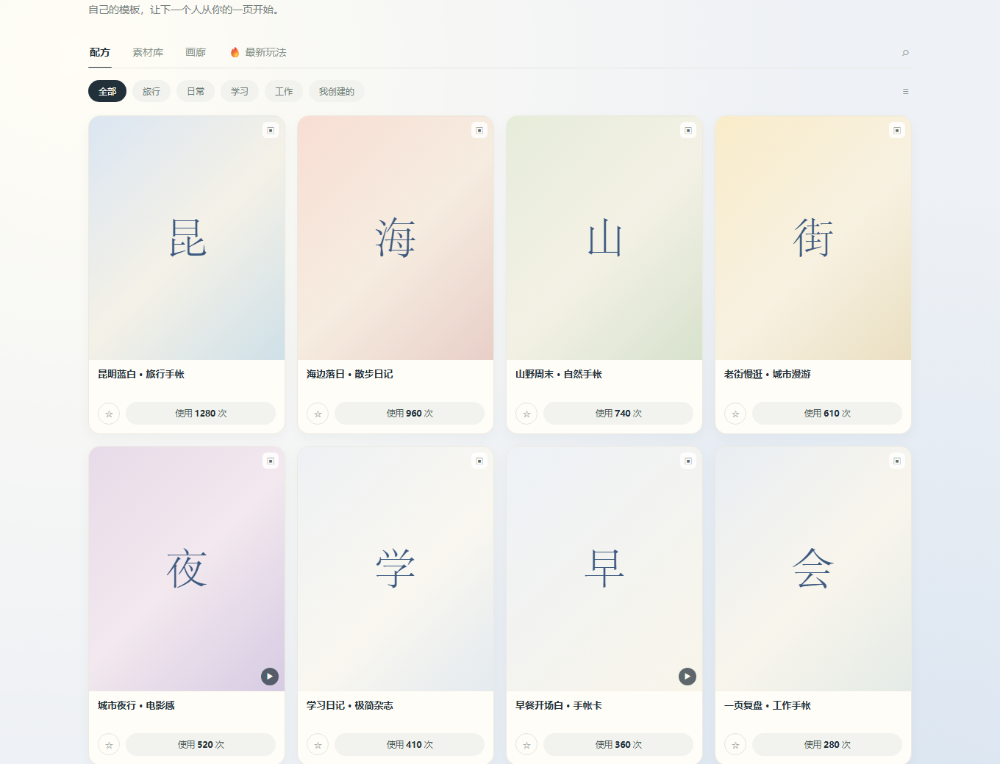
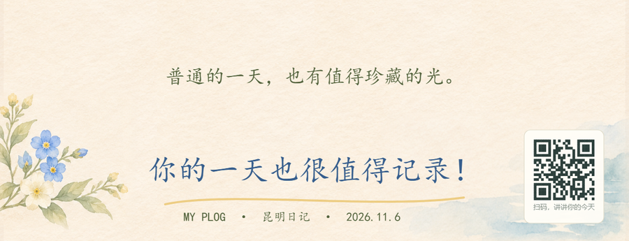

<div align="center">



# 一日一页 · One Day, One PLOG

**把散落的照片，变成一页能收藏的手帐长图。**
<sub>Photos in. A hand-drawn PLOG out.</sub>

<p>
  
  
  
  
  
</p>

<p>
  <a href="#quick-start">🚀 快速开始</a> ·
  <a href="#showcase">🖼️ 效果</a> ·
  <a href="#how-it-works">🧩 它是怎么工作的</a> ·
  <a href="#community">👥 社群配方库</a> ·
  <a href="#privacy">🔐 隐私与安全</a>
</p>

</div>

---

<a id="news"></a>

## 📢 新闻 · News

- **[2026.11]** 新增 **社群配方库**：8 个可套用模板，支持上传自己的模板与故事（本地存储，单人可用）。
- **[2026.11]** 长图右下角支持 **二维码**，扫码直接打开语音讲述页。
- **[2026.11]** 新增 **生成轨迹**：上传 → 精选 → 印花取样 → 成页，全过程可见。
- **[2026.10]** 首个可用版本：单个 HTML，豆包 Seed 视觉文案 + Seedream 水彩印花。

<a id="toc"></a>

## 📖 目录 · Table of Contents

| | |
|---|---|
| [这是什么](#what) | 一句话说清楚它解决什么问题 |
| [特性](#features) | 6 组能力，一张表看完 |
| [快速开始](#quick-start) | 3 分钟跑起来 |
| [效果](#showcase) | 真实生成的长图与界面 |
| [它是怎么工作的](#how-it-works) | 四步流程 + 两个接口 |
| [社群配方库](#community) | 借别人的配色与语气 |
| [项目结构](#structure) | 一个文件，几个素材 |
| [模型与接口](#models) | 用到的豆包能力 |
| [隐私与安全](#privacy) | Key、照片、音频怎么处理 |
| [路线图](#roadmap) | 接下来想做什么 |
| [致谢](#ack) | 站在谁的肩膀上 |

---

<a id="what"></a>

## 🧭 这是什么 · What is this

出去玩了一天，手机里躺着几百张照片；想发点什么，又懒得排版、不想写文案、不会画画。

**一日一页** 就是为这个瞬间做的：把照片丢进去，对着手机讲两句今天发生了什么，它会

1. **看懂照片**，挑出最值得留下的几张，写好标题、动线与每页旁的短句；
2. **从你的照片里取元素**（雪山、灯笼、海鸥、一束花、一段屋檐），重新画成水彩印花，落在留白处；
3. **拼成一页 1200px 宽的长图**——奶油底纸、错落的照片、手写旁注、齿孔边，最后在右下角留一枚可选的二维码。

它把「记录」这件事的动手成本，压到只剩**说话和选照片**。

> 和修图软件的区别：它不替你 P 图，是替你**把一天排成一页**。
> 和手帐 App 的区别：它不给你贴纸库，印花是**从你的照片里长出来的**。

---

<a id="features"></a>

## ✨ 特性 · Features

| 能力 | 说明 |
|---|---|
| 📷 **精选照片** | 支持 6 / 10 / 15 / 20 张，默认 10 张；避开相似连拍，兼顾人物、风景、美食与细节 |
| ✍️ **写成文案** | 标题 18 字内、开篇 50 字内、每张一句旁注 + 入选理由；不编造没发生的事 |
| 🎙️ **语音讲述** | 浏览器自带听写（Web Speech API），讲完可检查文字；没有麦克风就打字 |
| 🎨 **印花从照片里来** | 识别花朵、飞鸟、食物、建筑细节，取局部当参考，重画成水彩印花 |
| 🖌️ **6 套配色** | 春日蓝 / 鼠尾草 / 落日粉 / 宫崎骏 / 侯麦 / 王家卫，支持自定义氛围描述 |
| 📄 **长图成页** | 1200px 宽，可改标题、旁注、换图、调顺序，导出 PNG / JPG |
| 🔗 **长图二维码** | 右下角可选二维码，扫码打开语音讲述页，朋友也能讲一句自己的今天 |
| 👥 **社群配方库** | 8 个模板可一键套用；也能上传自己的模板、贴一段故事 |
| 📱 **手机版** | 网页里内嵌一个可操作的手机模拟器，独立数据互不影响 |
| 🧱 **零依赖单文件** | 一个 HTML，无需安装、无需后端，双击就能用 |

---

<a id="quick-start"></a>

## 🚀 快速开始 · Quick Start

### 1. 打开

直接双击 `index.html`，或用任意静态服务器：

```bash
# 任意一种都行
python -m http.server 8000
# 然后访问 http://localhost:8000
```

> 推荐 Chrome / Edge。语音听写需要麦克风权限；用 `localhost` 或 `https` 打开更稳妥。

### 2. 填一次自己的 Key

页面左栏底部的「让回忆成页」里：

1. 到 [火山方舟控制台](https://ark.volcengine.com/region:cn-beijing/apikey) 创建 API Key；
2. 在方舟里开通 **豆包视觉文案模型** 与 **Seedream 生图模型**；
3. 把 Key 粘进去 → 点「检查 Key 与模型连接」（只发一句测试文字，也会产生少量用量）。

> Key 不会写进浏览器存储。想连 Key 一起带着走，用「保存私用 HTML」导出一份**只有你自己能看**的副本。

### 3. 生成

```text
上传照片 → （可选）讲两句 → 点「✦ 精选照片，生成我的 Plog」
          → 等它画完水彩 → 拿到长图 → 改字 / 换图 → 导出
```

不想花额度时，可以点「仅试排版 · 内置底纸 · 不调用 API」，先用内置水彩底纸看排版。

---

<a id="showcase"></a>

## 🖼️ 效果 · Showcase



<p align="center"><i>桌面版首页：胶片带 + 一句话 + 印花原理 + 三步胶片 + 生成表单</i></p>

<table>
<tr>
<td width="50%"></td>
<td width="50%"></td>
</tr>
<tr>
<td align="center"><i>长图开头：标题、动线、第一页旁注</i></td>
<td align="center"><i>整张长图：1200 × 6367 px（示例，6 张照片）</i></td>
</tr>
</table>



<p align="center"><i>点一次生成，四步都由它完成；水彩没画好，长图不会出现</i></p>

<table>
<tr>
<td width="58%"></td>
<td width="42%"></td>
</tr>
<tr>
<td align="center"><i>社群：配方 / 素材库 / 画廊 / 最新玩法</i></td>
<td align="center"><i>长图右下角：可选的语音二维码</i></td>
</tr>
</table>

---

<a id="how-it-works"></a>

## 🧩 它是怎么工作的 · How it works

```text
    照片 + 讲述
        │
        ▼
┌───────────────────┐   一次视觉调用（结构化输出）
│ 豆包 Seed 2.1     │──▶ items[]（选片 / 标题 / 旁注）+ motifs[]（物件 + 归一化边界框）
└───────────────────┘
        │
        ▼
┌───────────────────┐   一次生图调用（参考图 + 提示词）
│ Seedream          │──▶ 2048² 水彩底纸：右上角主装饰 / 左侧次装饰 / 留白给照片
└───────────────────┘
        │
        ▼
┌───────────────────┐
│ Canvas 合成       │──▶ 1200px 长图：错落照片 + 手写旁注 + 齿孔 + 印章 + 二维码
└───────────────────┘
```

**几个实现上的取舍**

- **只调一次文案、一次生图**：文案接口用 `json_schema` 严格结构化，返回不合法直接报错重试，不会把半成品长图给你看。
- **印花只做局部**：模型返回物件的归一化 `box`，前端裁出那一小块作为参考图，提示词明确要求「不保留局部照片的背景、脸、人体、文字」。
- **原照片不重绘**：人物与照片原样保留，水彩只出现在留白处——这是它和「AI 换脸 / AI 赛博写真」最大的区别。
- **二维码自己画**：内置一个零依赖的 QR 编码器（字节模式 / 纠错 L / 版本 1–10 / 自动掩码），不引 CDN，离线也能画。

---

<a id="community"></a>

## 👥 社群配方库 · Community

「今天真的想不出写什么」的人，可以先借别人一页。

- **配方**：8 个模板，每个都带配色、叙事风格、精选张数与一句文案骨架。点「使用」→ 风格写进表单，照片仍是你自己的。
- **素材库**：从照片里重绘出来的水彩印花（花环 / 海鸥 / 花枝），可以直接看它们怎么用。
- **画廊**：真实生成的长图切片，点开看整页。
- **最新玩法**：最新的故事与配方；故事可以直接当讲述的开头。
- **上传**：把自己的一页放上去，写一句骨架，别人就能从你的语气开始。

> ⚠️ 当前是**单文件本地版**：模板与故事存在浏览器 `localStorage` 里，方便自己与家人朋友试用；接一个轻后端（KV / Supabase / 自建）后即可多人共享。

---

<a id="structure"></a>

## 🗂️ 项目结构 · Structure

```text
.
├── index.html                 # 全部功能：UI + 排版 + 长图合成 + QR 编码器（单文件）
├── assets/                    # README 用图
│   ├── hero.png
│   ├── shot-home.png
│   ├── shot-poster-top.png
│   ├── shot-poster-full.png
│   ├── shot-community.png
│   ├── shot-qr.png
│   └── steps.png
├── LICENSE
└── README.md
```

`index.html` 里没有构建步骤、没有 `node_modules`、没有 CDN：样式、脚本、示例图片、二维码编码器全部内联。

---

<a id="models"></a>

## 🧠 模型与接口 · Models & APIs

| 用途 | 模型（默认） | 接口 |
|---|---|---|
| 看图 + 选片 + 写文案 | `doubao-seed-2-1-lite-260915` | `POST /api/v3/responses`（`json_schema` 结构化输出） |
| 重绘水彩印花底纸 | `doubao-seedream-5-0-flash-260915` | `POST /api/v3/images/generations` |

- 区域：`cn-beijing`；两处模型 ID 都可以在页面里直接改（左栏「背景模型」与「模型与使用说明」）。
- **只看得到 768px 缩略图**：原图留在本地，发给模型的是缩略图，长图合成用的是本地 2200px 版本。

---

<a id="privacy"></a>

## 🔐 隐私与安全 · Privacy

- **Key**：默认不写入 `localStorage`，刷新即失效；只有你主动点「保存私用 HTML」时，Key 才会写进那份下载文件里，**请只自己保管**。
- **照片**：以 768px 缩略图发送给豆包 / 火山方舟；原图不上传、不落地到任何第三方。
- **音频**：不做录音转写，语音由浏览器自带的听写服务处理（是否联网取决于浏览器），音频不会发送到豆包。
- **长图**：导出的 PNG / JPG 里**不含 Key**；二维码只包含你填的那一行地址。

> ⚠️ **公开部署前请自查**：用「保存私用 HTML」导出的副本会在 `<head>` 里带一段
> `<meta name="plog-private-key" content="...">`。把它推到公开仓库前，请先删掉这段，或者直接用本仓库里这份
> 已经清理过的 `index.html`。若 Key 曾经进过任何公开仓库，请立刻在方舟控制台**吊销并重建**。

---

<a id="roadmap"></a>

## 🗺️ 路线图 · Roadmap

- [ ] **真正的多人配方库**：接轻后端，模板与「使用 N 次」共享
- [ ] **短链二维码**：`/v/ab12cd`，让码更小更好扫
- [ ] **配方预览浮层**：点卡片先看长图效果再套用
- [ ] **每组照片的生成轨迹留档**：每次生成都留一条可回看的过程
- [ ] **英文界面**：面向海外华人与旅行博主
- [ ] **离线底纸包**：几套预置水彩底纸，完全断网也能玩

---

<a id="ack"></a>

## 🙏 致谢 · Acknowledgements

- 视觉理解与文案：[豆包 Seed](https://www.volcengine.com/product/doubao)（火山方舟）
- 水彩印花生成：[Seedream](https://www.volcengine.com/product/seedream)
- 内置水彩底纸：由 imagegen 生成后内嵌
- 字体：思源宋体 / 楷体（跟随系统字体回退）

---

## 📄 License

[MIT](LICENSE) © 2026 一日一页

<div align="center">
<sub>如果这一页帮你留下了一天，欢迎点一颗 ⭐</sub>
</div>
